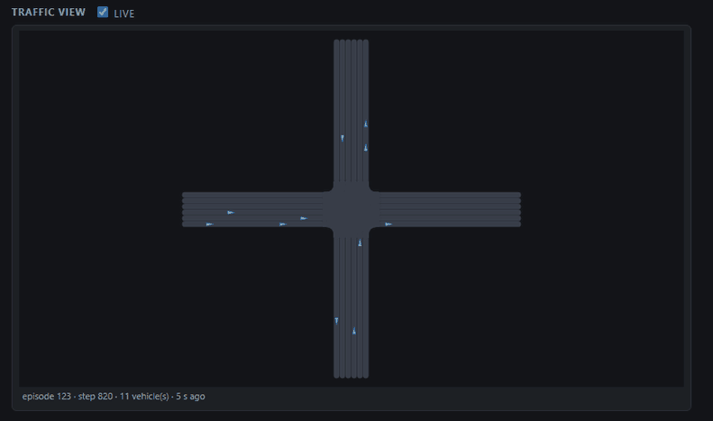

# OpenCDA-MARL

OpenCDA-MARL extends the original OpenCDA framework with **Multi-Agent Reinforcement Learning (MARL)** capabilities for cooperative driving automation research. Building upon OpenCDA's co-simulation-based framework integrated with prototype cooperative driving automation (CDA; see [SAE J3216](https://www.sae.org/standards/content/j3216_202005/)) pipelines, OpenCDA-MARL adds advanced MARL algorithms and training infrastructure for developing intelligent multi-agent driving policies in complex traffic scenarios.

OpenCDA-MARL combines the robust simulation capabilities of the original OpenCDA with state-of-the-art MARL algorithms to enable researchers to train and evaluate cooperative multi-agent driving policies. This extension supports various MARL paradigms including centralized training with decentralized execution (CTDE), communication-based cooperation, and emergent behaviors in mixed autonomy traffic.

The key features of OpenCDA-MARL are:

* <strong>MARL Integration</strong>: Multi-agent learners out of the box — MAPPO, MASAC, MATD3, DQN and tabular Q-learning; PCMAPPO and PCMASAC build on [PCMA](https://arxiv.org/abs/2606.14693) (preference-coordinated multi-agent policy optimization, without its Dirichlet preference planner) for multi-objective training, and PCMATD3 is preference-conditioned only.
* <strong>Research Pipeline</strong>: Rich research pipelines including both rule-based CDA modules and learning-based MARL agents for platooning, cooperative perception, and traffic coordination.
* <strong>Integration</strong>: Seamless integration with CARLA and SUMO, plus a PettingZoo `ParallelEnv` port so the same scenarios can be driven by external RL stacks.
* <strong>Full-stack Simulation</strong>: Complete automated and cooperative driving platform in Python with perception, localization, planning, control, V2X communication, and MARL decision-making modules.
* <strong>Modularity</strong>: Highly modularized architecture allowing easy swapping between rule-based and learning-based components.
* <strong>Benchmark</strong>: MARL-specific benchmarks, training scenarios, and evaluation metrics for multi-agent driving tasks.
* <strong>Scalability</strong>: An experiment matrix launcher that runs independent training cells concurrently, one CARLA server per slot, spread over the GPUs of a multi-GPU machine.
* <strong>Mixed Autonomy</strong>: Support for mixed traffic with human-driven vehicles, rule-based AVs, and learning-based agents.

Users can refer to our [documentation](https://radar-lab.github.io/OpenCDA-MARL/) for detailed guides on MARL integration and training procedures. For the original OpenCDA documentation, visit [OpenCDA documentation](https://opencda-documentation.readthedocs.io/en/latest/).

## What's New in OpenCDA-MARL

### v2.1.0

The first 2.x release
([changelog](https://radar-lab.github.io/OpenCDA-MARL/marl/changelog/v2.1.0/)).

* **A library, not just a repo**: the wheel (`pixi run wheel`, then
  `pip install dist/opencda_marl-*.whl`) gives the environment, the
  lifecycle, the SUMO benchmark (configs, replay and network bundled) and the
  baseline learners — plus an `opencda-marl run` CLI. Every
  algorithm, the bundled MAPPO / MASAC / MATD3 / DQN / Q-learning families
  included, arrives through the `opencda_marl.plugins` entry point (or
  `OPENCDA_MARL_PLUGINS` / `MARL.plugins`): a research repository imports the
  library and registers its own components without touching it. Cloned this
  repo instead? Drop a module into `opencda_marl/builtin/algorithms/contrib/` and it is
  discovered automatically (`contrib/random_speed.py` is the reference — see
  [Add an Algorithm](https://radar-lab.github.io/OpenCDA-MARL/marl/custom_algorithms/)).
* **Verified lifecycle**: one episode loop across both backends, CARLA world
  reloads that carry the full learner state (networks, optimizers, replay and
  rollout buffers, normalizers), and resumable runs.
* **SUMO backend**: the same scenarios and learners without CARLA, using
  libsumo where available — orders of magnitude faster per step for algorithm
  work.
* **PettingZoo ParallelEnv port**: drive the scenarios from external RL stacks.
* **Experiment infrastructure**: the matrix launcher (`scripts/experiments/`)
  with parallel cells, per-slot CARLA servers, GPU spreading and `--resume`,
  plus opt-in throughput features — a CUDA-graph SAC update and value
  normalization for the PPO family (see
  [Run Experiments](https://radar-lab.github.io/OpenCDA-MARL/run-experiments/)).
* **Metrics store and monitor**: every run writes a per-run SQLite store and
  starts (or reuses) a dependency-free web monitor that overlays runs, lists
  episode summaries and draws a live schematic traffic view of headless runs.
  TensorBoard event files are also written by default (`pixi run tensorboard`
  serves them); the monitor does not need them.
* **Agent-ready workflow**: `AGENTS.md` / `CLAUDE.md` plus the
  [Agent Workflow](https://radar-lab.github.io/OpenCDA-MARL/agents/workflow/)
  page define how coding agents and people make, verify and submit changes,
  and the [Code Index](https://radar-lab.github.io/OpenCDA-MARL/agents/code-index/)
  maps the code for them.

## Major Components


OpenCDA-MARL extends the original four components with MARL-specific modules:

* <strong>MARL Training Framework</strong>: Training infrastructure for the registered learners (MAPPO/MASAC/MATD3/DQN/Q-learning and the preference-conditioned PCMAPPO/PCMASAC/PCMATD3), on CARLA or SUMO
* <strong>Cooperative Driving System</strong>: Enhanced with learning-based decision making for cooperative driving tasks
* <strong>Data Manager and Repository</strong>: Training data collection and replay buffer management
* <strong>Scenario Manager</strong>: MARL-specific training and evaluation scenarios

Check our [documentation](https://radar-lab.github.io/OpenCDA-MARL/) for how to run experiments and plug in an algorithm.

## Get Started

 

### Users Guide

* [Overview](https://radar-lab.github.io/OpenCDA-MARL/)
* [Installation](https://radar-lab.github.io/OpenCDA-MARL/installation/)
* [Quick Start](https://radar-lab.github.io/OpenCDA-MARL/quick-start/)
* [CARLA Version Support](https://radar-lab.github.io/OpenCDA-MARL/carla-version-support/)
* [Architecture](https://radar-lab.github.io/OpenCDA-MARL/marl/architecture/)
* [Run Experiments](https://radar-lab.github.io/OpenCDA-MARL/run-experiments/)

Note: We continuously improve the performance of OpenCDA-MARL. Currently, it is mainly tested in our customized maps. However, we <strong>DO NOT </strong> guarantee the same level of robustness in other maps. We will update the documentation and the maps in the future.

The root Windows manifest now uses `CARLA 0.9.16 + Python 3.12` as the default experiment path. A dedicated `CARLA 0.9.15 + Python 3.10` backup manifest remains in `dependencies/pixi/pixi_win_py310_carla0915_backup.toml`, alongside the explicit `CARLA 0.9.15 + Python 3.12` manifest and an experimental `CARLA 0.10.0 + Python 3.12` path for import-level evaluation.

MARL-family configs can now be selected explicitly with prefixes such as `marl/<name>`, `pcma/<name>`, `momarl/<name>`, and `sumo-marl/<name>` when using `--marl`. Stable framework families ship as package data under `opencda_marl/_bundled/configs/`; additional experimental families can be loaded from custom config roots with `--marl-config-root` or `OPENCDA_MARL_CONFIG_ROOTS`.

### Developer Guide

* [Add an Algorithm](https://radar-lab.github.io/OpenCDA-MARL/marl/custom_algorithms/)
* [Agent Workflow](https://radar-lab.github.io/OpenCDA-MARL/agents/workflow/) — how changes are made, verified and merged
* [Code Index](https://radar-lab.github.io/OpenCDA-MARL/agents/code-index/) — where things live, how a run executes, the extension points
* [OpenCDA Patch Ledger](https://radar-lab.github.io/OpenCDA-MARL/opencda/marl_patches/)

### Contributing

Contributions by people and by coding agents are welcome — see the
[Contributing Guide](docs/contributing.md) and the
[Agent Workflow](https://radar-lab.github.io/OpenCDA-MARL/agents/workflow/).

For quick reference:

* Report bugs and improvements by submitting [issues](https://github.com/radar-lab/OpenCDA-MARL/issues)
* Submit contributions via [pull requests](https://github.com/radar-lab/OpenCDA-MARL/pulls) using our [PR template](.github/PR_TEMPLATE.md)

## Citation

If you are using OpenCDA-MARL for your research, please cite both the MARL extension and the original OpenCDA paper:

```bibtex
@ARTICLE{11396022,
  author={Guo, Lihao and Liu, Louis and Tang, Jiahao and Liu, Bo and Cao, Siyang},
  journal={IEEE Robotics and Automation Letters}, 
  title={OpenCDA-MARL: A Unified Benchmarking Framework for Cooperative Autonomous Intersection Management With Multi-Agent Reinforcement Learning}, 
  year={2026},
  volume={11},
  number={4},
  pages={4291-4298},
  keywords={Vehicle dynamics;Training;Robot sensing systems;Heuristic algorithms;Vehicle-to-everything;Benchmark testing;Real-time systems;Monitoring;Laser radar;Graphical user interfaces;Autonomous driving;benchmark testing;connected vehicles;cooperative systems;deep reinforcement learning;multi-agent systems;reinforcement learning;simulation},
  doi={10.1109/LRA.2026.3664656}
}


@misc{xu2021opencdaanopencooperativedriving,
      title={OpenCDA:An Open Cooperative Driving Automation Framework Integrated with Co-Simulation}, 
      author={Runsheng Xu and Yi Guo and Xu Han and Xin Xia and Hao Xiang and Jiaqi Ma},
      year={2021},
      eprint={2107.06260},
      archivePrefix={arXiv},
      primaryClass={cs.RO},
      url={https://arxiv.org/abs/2107.06260}, 
}
```

The preference-conditioned learners (PCMASAC / PCMAPPO / PCMATD3) build on
*Preference Coordinated Multi-agent Policy Optimization* (PCMA), without its
Dirichlet preference planner. If you use them, please also cite:

```bibtex
@misc{wang2026pcma,
  title={Learning Coordinated Preference for Multi-Objective Multi-Agent Reinforcement Learning},
  author={Pengxin Wang and Lihao Guo and Yi Xie and Bo Liu and Siyang Cao and Jingdi Chen},
  year={2026},
  eprint={2606.14693},
  archivePrefix={arXiv},
  primaryClass={cs.MA},
  url={https://arxiv.org/abs/2606.14693},
}
```

What the implementation does, layer by layer, is documented in
[PCMA Learners](https://radar-lab.github.io/OpenCDA-MARL/marl/pcma/).

The arxiv link to the OpenCDA paper:  <https://arxiv.org/abs/2107.06260>

## License

The code written for OpenCDA-MARL (the `opencda_marl` package, scripts, tests, configuration profiles and
documentation) is licensed under the [Apache License 2.0](LICENSE); see also [NOTICE](NOTICE).

The vendored OpenCDA core (`opencda/`, `opencda.py` and the files derived from it) remains under the UCLA Mobility
Lab's Academic Software License: academic and nonprofit research use only, and no further transfer of the software
or its derivatives; commercial users should contact the UCLA Mobility Lab as that licence says. A running
installation includes that core, so use of the complete system is limited by UCLA's licence to academic and
nonprofit research; this does not narrow what the Apache License allows for our own files. CARLA code and map
data and the other third-party material keep their own terms. [THIRD_PARTY_NOTICES.md](THIRD_PARTY_NOTICES.md)
lists each part, the paths it occupies and its terms, and reproduces UCLA's licence text.

## Contributors

### OpenCDA-MARL Team

The MARL extension is developed and maintained by researchers focusing on multi-agent reinforcement learning for autonomous driving.

* **Project Lead**: Lihao Guo
* **Core Team**: Louis Liu, Jiahao Tang
* **Advisors**: Dr. Liu Bo, Dr. Siyang Cao

### OpenCDA Team

OpenCDA is originally developed by the [UCLA Mobility Lab](https://mobility-lab.seas.ucla.edu/):

* **Principal Investigator**: Dr. Jiaqi Ma ([UCLA Samueli](https://samueli.ucla.edu/people/jiaqi-ma/))
* **Project Lead**: Runsheng Xu ([github](https://github.com/DerrickXuNu))
* **Core Team**: Xu Han, Hao Xiang, Zhaoliang Zheng, Zonglin Meng, Dr. Xin Xia

### Acknowledgements

* [UA Radar lab](https://github.com/radar-lab)
* [UCLA Mobility Lab](https://mobility-lab.seas.ucla.edu/)
* UC Davis Professor [Junshan Zhang's](https://faculty.engineering.ucdavis.edu/jzhang/) group for openScenario integration
* @GoodarzMehr for Docker support
* All contributors to the OpenCDA and OpenCDA-MARL projects
