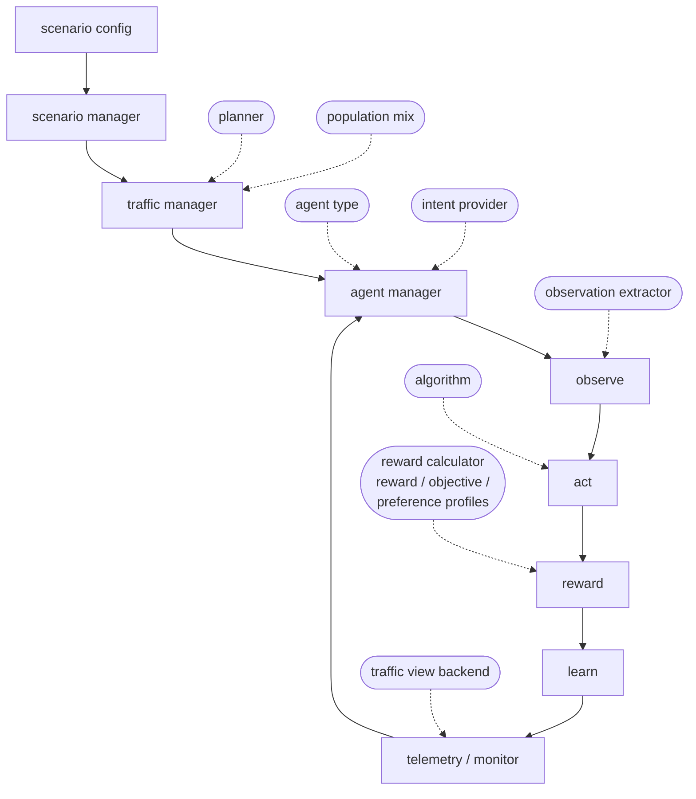

# Architecture

One sealed lifecycle, many replaceable joints. The framework fixes *how a
run executes* — world, traffic, agents, observe, act, reward, learn,
telemetry — and turns every part an experiment might vary into a plugin
selected by configuration. The intended workflow: a research project varies one
component behind one joint, and the validated component integrates back
without the loop ever changing shape. This page is the map of those joints; [Replace a
Component](replace_component.md) is the practice — the mechanism, then
one worked page per kind, of which [Add an
Algorithm](custom_algorithms.md) covers the largest.

## The four zones

| zone | contents | import rule |
|---|---|---|
| `opencda_marl/_kernel/` | the complete lifecycle: scenario manager, traffic, agent manager, envs, policy manager, checkpointing | never imports `builtin` — the kernel knows contracts, not implementations |
| `opencda_marl/api/` | every contract and every `register_*` door | the only surface plugins and external code touch |
| `opencda_marl/plugins/` | the one plugin system: discovery, loading, freeze, rollback | — |
| `opencda_marl/builtin/` | the framework's own plugin set (learners, planners, agents, extractors, rewards, intent providers) | registers through the same doors an external package would |

The boundary is enforced, not conventional: `test/basic/test_architecture.py`
parses the imports of every kernel module and fails on a violation.

## The run loop and its joints

Solid arrows are the sealed loop; dashed nodes are the joints. The loop is
identical on both backends — CARLA (`marl/`, `pcma/`, `momarl/` families)
and SUMO (`sumo-marl/`) — so a component validated on one transfers to the
other unchanged. The one exception is the `agent` kind: an agent factory
drives a CARLA vehicle, and on SUMO a population key is only a label
(vehicles outside the learner's population drive under SUMO's own
car-following model).

## Replaceable joints

Every joint is a *kind* in one unified registry. Registration happens at
import time through `opencda_marl.api`; `pixi run python -m
opencda_marl.plugins` lists what is registered and from where.

| kind | contract | register through | selected by | built-ins |
|---|---|---|---|---|
| `algorithm` | `Policy` protocol (+`IntentPolicy` for path heads), `PolicyCapabilities` — `opencda_marl.api.policy` | `register_algorithm` | `MARL.algorithm` | `masac`, `pcmasac`, `mappo`, `pcmappo`, `matd3`, `pcmatd3`, `dqn`, `q_learning` |
| `planner` | class with constructor `(world, config)` | `register_component("planner", key)` | `scenario.traffic.planner.type` | `marl` |
| `agent` | factory `(vehicle, carla_map, config)`; resolved on CARLA only | `register_component("agent", key)` | `agents.agent_type` (globally) or `agents.population.mix` (per vehicle) | `marl`, `rule_based`, `vanilla`, `behavior`; the no-learner baselines are exactly `behavior`, `vanilla` and `rule_based` (`BASELINE_AGENT_TYPES` is closed) |
| `reward_calculator` | produces `RewardOutput` per agent (`opencda_marl.api.contracts`) | `register_component("reward_calculator", key)` | `MARL.components.reward_calculator` | `default` |
| `observation_extractor` | maps raw observations to the declared feature vector | `register_component("observation_extractor", key)` | `MARL.components.observation_extractor` | `default` |
| `intent_provider` | `IntentProvider`: spawn context → `RouteIntentDecision` (`opencda_marl.api.intent`) | `register_component("intent_provider", key)` | `MARL.action_space.path.provider: <any registered key>`; without it, `MARL.action_space.path.selector` names a built-in (`keep_current`→`tao_fixed`, `random_legal`→`naive_random`, `rule_based`→`rule_based_path`, `learned`→the policy bridge) | `tao_fixed`, `naive_random`, `rule_based_path` |
| `reward_profile` | a named parameter table | `register_reward_profile` | `MARL.reward_profile` | `simple_progress_v1`, `dense_intersection_v1`, `cooperative_intersection_v1`, `competitive_intersection_v1/_v2` |
| `objective_profile` | the objective vector definition | `register_objective_profile` | `MARL.objective_mode` | `cooperative_pref_v1`, `competitive_ordering_v1` |
| `preference_profile` | a named preference table (by entry direction) | `register_preference_profile` | `MARL.preference.profile` | `balanced`, `asymmetric_split`, `reversed_asymmetric_split`, `mild_asymmetric_split` |
| `context_encoder` | module with `forward(sequences)` / `forward_padded(sequences, lengths)` over the ego-first, nearest-first neighbour sequence; constructor `(input_size, hidden_size, num_layers)` | `register_component("context_encoder", key)` | `MARL.<algo>.context_encoder` | `lstm` |
| *your own axis* | whatever your experiment needs | `register_component("your_kind", key)` — unknown kinds are accepted and listed | your config key | — |

How a plugin package reaches the registry — an `opencda_marl.plugins` entry
point, `MARL.plugins` in config, `$OPENCDA_MARL_PLUGINS`, or a module
dropped into `builtin/algorithms/contrib/` — is covered in
[Add an Algorithm](custom_algorithms.md#making-it-discoverable).

## Ports

Not everything replaceable is a registry kind; these are seams by contract
rather than by key:

| port | contract | where |
|---|---|---|
| drive the scenarios from your own RL loop | PettingZoo-style `ParallelEnv` | `opencda_marl/envs/parallel_env.py` |
| a new monitor chart | vanilla JS against the `/api/runs/...` endpoints, no build step | `opencda_marl/telemetry/static/` |
| feed the live traffic view from a new backend | `collect_traffic_view()` / `collect_traffic_geometry()` on the env | `opencda_marl/telemetry/traffic_view.py` documents the file shapes, including the `y_up` frame flag |
| a new scenario or profile | a YAML stating only what changes | `opencda_marl/_bundled/configs/<family>/<scenario>/`, or the same path under your own `--marl-config-root` |
| a new deterministic traffic recording | record mode writes one as run output; adopting it as a benchmark is a copy into the package | `artifacts/recordings/` → `opencda_marl/_bundled/recordings/` |

## Adjustable seams

The joints above swap implementations; these config-level seams change what
the *fixed* loop does — each one is a configuration axis:

| seam | key | meaning |
|---|---|---|
| mixed autonomy | `agents.population: {mix: {marl: 0.5, rule_based: 0.5}, seed: N}` | shares exact over each window of `resolution` vehicles, reproducible per seed (a shorter prefix only approximates them; live flows draw flow by flow). The learner commands (speed and path actions, at spawn and at the approach decision zone) and learns from its own population, `agents.agent_type`, only; background vehicles keep their demand routes and stay in the traffic context. The mix must name `agents.agent_type`, or the learner gets no vehicle. On CARLA the mix is checked at construction: a mix without the learning population is rejected, a zero learner share warns, and every positive-share name must be a registered agent type (matched exactly, case-sensitive). On SUMO every other name is background traffic SUMO drives itself |
| what one path action means | `MARL.action_space.path.provider: <registered intent_provider>` | the built-in semantic action (left / straight / right / keep) is the example; a provider declares its own alternatives, mask and head width through `opencda_marl.api.path_action` |
| when the path decision happens | `MARL.action_space.path.decision_zone: {trigger: spawn \| approach, distance_m}` | decide at spawn, or on approaching the junction |
| committed exit lanes in the observation | `MARL.<algo>.features.committed_exit_lanes: <width>` | per exit lane, how many other vehicles at the same junction have already committed to it, in `<width>` slots; off by default, and the state dimension changes with it |
| per-vehicle objective preferences | `agents.preference: {mode, sampler, dim, alpha, seed, regime}` | the spawn-time sampler; `regime: aligned \| conflicting` decides whether preference-heterogeneous vehicles meet |
| traffic determinism | `scenario.traffic.mode: replay \| live \| record` | the bundled recordings are evaluation ground truth |
| per-vehicle driver behaviour | `metadata.driver` on a spawn event | reaches the agent factory as `config["spawn_metadata"]`, and on SUMO is applied to background vehicles (`speed_factor`, `tau`, `min_gap`, `imperfection`, `accel`, `decel`) |
| the SUMO frame convention | `runtime.coordinate_landmarks` | junction landmarks in CARLA's frame decide `y_flip`; a `<net>_landmarks.json` (or `<net>_junction_graph.json`) next to the network is found without configuration, keyed by junction id either flat, `{"12": [x, y]}`, or nested, `{"junctions": {"12": {"centre": [x, y]}}}`. A map with none keeps the default, no y flip, so a CARLA town export needs landmarks |
| the map, on both backends | CARLA: `scenario.map.town` or `scenario.map.xodr_path`; SUMO: `runtime.sumo_cfg` | an `.xodr` builds the CARLA world from the road network alone. SUMO does not read `scenario.map`: it loads the network named by the `<net-file>` of the `.sumocfg` at `runtime.sumo_cfg`, so a `.sumocfg` naming the derived `.net.xml` pairs the two, and SUMO reads that network in CARLA's frame only with the landmarks above. No `.sumocfg` names the derived town networks in `opencda_marl/assets/maps/`, and no landmarks ship for any town ([Run Experiments](../run-experiments.md#maps-on-both-backends)) |

> Historical note: the path-intent axis is identified as `route_intent` in
> code, metadata and traces — the name predates the pluggable path action.
> It still covers what the axis does (choose the way out of the junction,
> by whatever alternatives its provider offers); the preference sampler, which conditions
> objectives rather than routes, moved to `agents.preference`
> (`agents.route_intent.preference` still works).

## Rules the joints live under

- **Load once, then freeze.** Plugins register at import time during
  startup; afterwards the registry is frozen — no hot reload, so what ran
  is what was listed.
- **No silent shadowing.** Overriding an existing key — built-ins included —
  requires `override=True`; a typo cannot replace a component quietly.
- **Version rollback.** A plugin whose declared API version mismatches is
  rolled back as a unit, across every kind it registered.
- **Config composes.** Three layers per scenario reference
  (`default.yaml` → `base.yaml` → profile), `include:` for reuse, external
  roots via `--marl-config-root`; a profile states only what it changes.
- **Contracts are pinned by tests**, not by convention:
  `test/basic/test_architecture.py` (zones), `test/route_intent/` (registry,
  policy contract, components, intent), `test/basic/test_config_lint.py`
  (every shipped profile resolves).
